# Dashboard Designer tutorial

<p class="byline">Reactor Dashboard Designer v1.61 · Concert Workbench v1.76 · 24 October 2026</p>

A hands-on guide to building Concert Operate dashboards with the Reactor Dashboard Designer: from an empty canvas to live widgets, linked drill-downs, Action flows that call Concert Operate, and deployment into the Reactor menu.

[TOC]

## 0. Before you start: get the code and run the Workbench

You need git, Node.js 22, access to the GitHub repository and, for deploying, the cluster's details.

### Get the code (first time)

```
git clone https://github.com/postoyko/reactor.git
cd reactor
git checkout main                     # or the branch your team works on
cd dashboard-extension && npm ci && cd ..
```

### Every day

```
cd reactor
git status                            # anything not committed?
git pull                              # bring in what others pushed
```

To work on another branch: `git fetch origin`, then `git checkout <branch>`. `git branch --show-current` shows where you are. Commit your changes first (or put them aside with `git stash`), otherwise git refuses to switch.

### Start the Workbench

```
cd scaffold
node server.mjs                       # or: npm start
```

Open http://127.0.0.1:4000. It runs on your computer only; stop it with `Ctrl+C`. It has four tabs:

| Tab | For |
| --- | --- |
| **Pages** | Every page in the Concert Operate sidebar: rename it, choose whether it deploys and shows in the sidebar, protect hand-written dashboards from being overwritten, add or remove pages |
| **Design** | The Dashboard Designer on sample data (this tutorial) |
| **Deploy** | Builds the extension and deploys it, with a live log |
| **Setup** | Install or update the Designer, Git settings, the topology proxy, splitting dashboards into tiles |

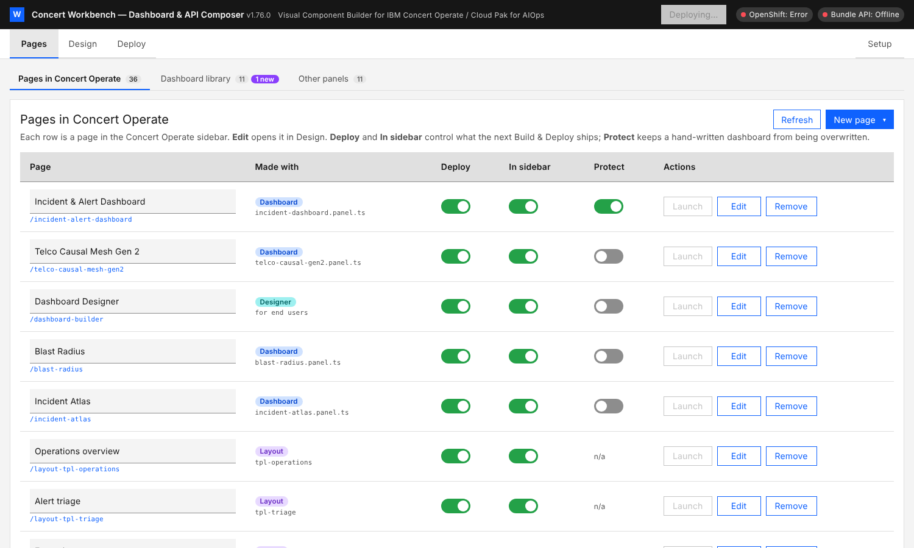

First time only: **Setup › Install / Update Designer**, then deploy.

### What deploying needs (once per computer)

- `dashboard-extension/target.json`: the Concert Operate address, user, API key, tenant and bundle name. It holds a key, so git ignores it: never commit it.
- `export OPENSHIFT_PASSWORD='…'` (and `OPENSHIFT_USER` if it is not kubeadmin) in the terminal that starts the Workbench or runs `./deploy-dashboards.sh`.
- The OpenShift address is currently written in `dashboard-extension/fast-deploy.mjs`; change it there for another cluster.

After every deploy, hard-refresh Concert Operate (`Cmd+Shift+R`, or `Ctrl+Shift+R` on Windows).

## 1. Getting started

The Designer lives in two places:

- **Concert Workbench** (local): run `node scaffold/server.mjs`, open http://127.0.0.1:4000 and choose the **Design** tab. It runs on sample data, so you can build safely without a cluster.
- **Concert Operate**: once deployed, open **Reactor › Dashboard Designer** in the sidebar. The same editor, reading your live tenant.

The Designer always opens on an **empty dashboard**. The start screen offers a **Blank dashboard** or a head start from a template. Everything a template adds is an ordinary widget you can change, rewire or delete.

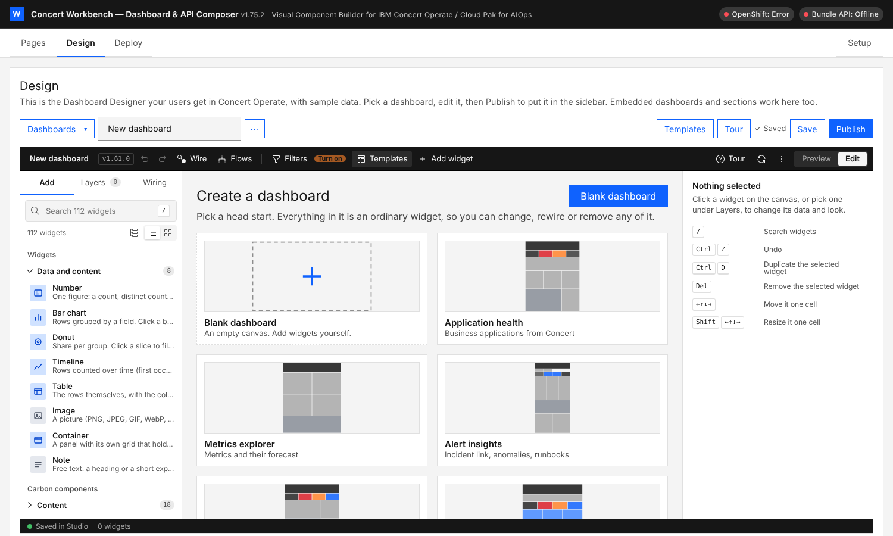

The first visit also runs a short **Tour** (9 steps). Skip it, or reopen it at any time from **Tour** in the toolbar.

**Try it:** choose **Blank dashboard**, name it in the box at the top (“New dashboard”), then **Save**.

## 2. The editor layout

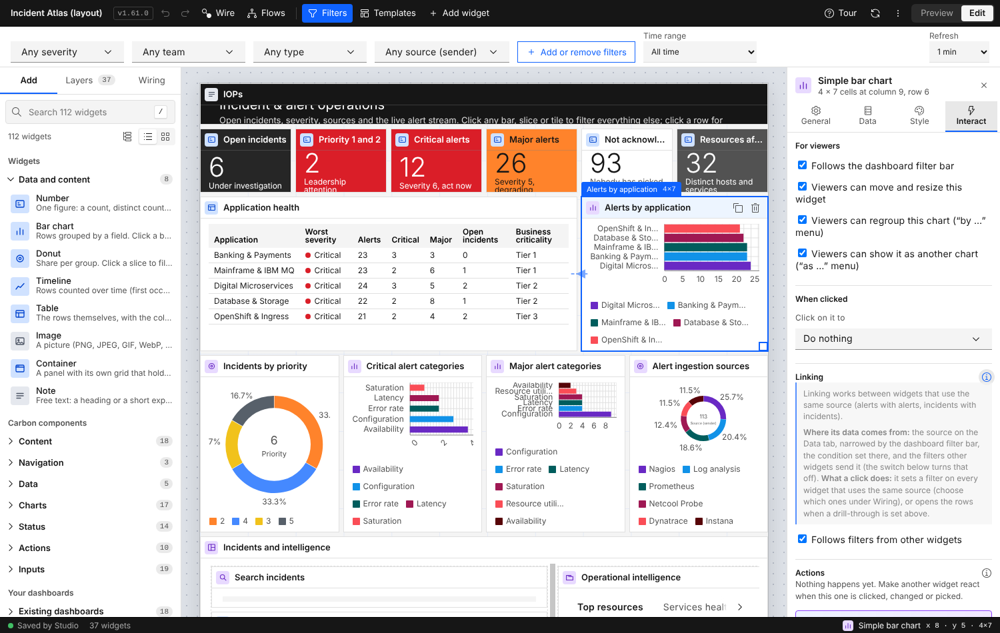

| Area | What it is for |
| --- | --- |
| **Toolbar** (top) | Undo / redo, **Wire**, **Flows** (the Action flows editor), **Filters**, **Templates**, **Add widget**, **Tour**, refresh, the ⋮ menu (API check, import / export) and the **Preview / Edit** switch |
| **Filter bar** | Dashboard-wide filters (severity, team, type, source), **Add or remove filters**, **Time range** and **Refresh** interval |
| **Left panel** | **Add** (the widget library), **Layers** (every widget, nested as on the canvas) and **Wiring** (who filters whom) |
| **Canvas** | A 12-column grid. Click a widget to select it; its size shows on a blue tag (e.g. `4×7`) |
| **Right panel** | Settings of the selected widget, in four tabs. With nothing selected it lists the keyboard shortcuts |
| **Status bar** (bottom) | Save state, widget count and the selected widget’s position and size |

Keyboard shortcuts: `/` search widgets · `Ctrl Z` undo · `Ctrl D` duplicate · `Del` remove · arrows move one cell · `Shift`+arrows resize one cell.

## 3. Adding and arranging widgets

The **Add** tab holds 112 widgets in groups: **Data and content** (Number, Bar chart, Donut, Timeline, Table, Image, Container, Note), then the **Carbon components** (Content, Navigation, Data, Charts, Status, Actions, Inputs) and **Your dashboards** (embed an existing dashboard).

<div class="narrow" markdown="1">
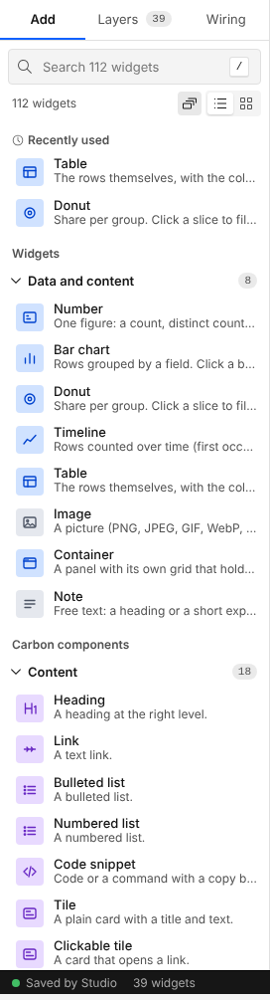
</div>

- **Search** (`/`): matches words anywhere in the name or description and highlights them.
- **List / grid** switch, and **expand / collapse all** groups.
- **Recently used** keeps your last picks at the top.

To add a widget, **click** it (it lands in the first free space) or **drag** it onto the canvas. Then:

1. **Move**: drag its title bar, or use the arrow keys.
2. **Resize**: drag the bottom-right corner, or `Shift`+arrows.
3. **Nest**: drop it into a Container, Tabs or Split pane, or use **Place in** on the General tab.
4. **Duplicate / delete**: the icons on its title bar, or `Ctrl D` / `Del`.

The **Layers** tab is the quickest way to find and select a widget on a busy dashboard.

### Widgets inside widgets

Containers hold other widgets: **Container**, **Tabs**, **Accordion**, **Split pane** (resizable), **Scroll pane**, **Carousel** and **Toolbar**. Drag a widget or a library item onto one (for Tabs, click the tab first), or use **Place in** on the General tab. Up to three levels deep; **Layers** shows the nesting.

**Existing dashboards as tiles.** The **Your dashboards** group places a hand-written dashboard (Incident Atlas, Blast Radius…) as one tile, or one of its sections. In the Workbench, a selected tile offers **Break into widgets** or **Turn this section into widgets** when the Designer has equivalent widgets.

**Undo / redo** keeps the last 50 steps.


## 4. Widget settings: General, Data, Style, Interact

Select a widget and the right panel shows its settings in four tabs. Each section heading has an **(i)** button that explains it.

<div class="tabs4" markdown="1">
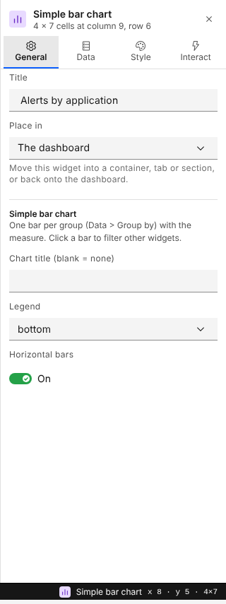
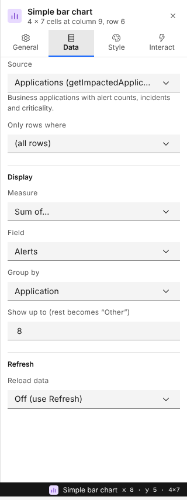
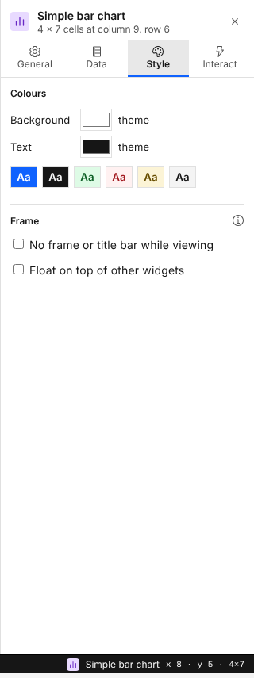
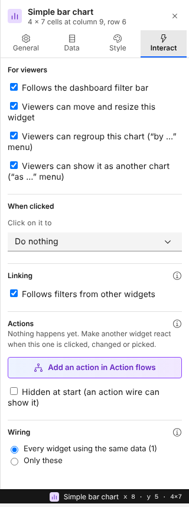
</div>

**General**: the title, **Place in** (the dashboard, or a container / tab / section), and the widget’s own options (chart title, legend position, horizontal bars and so on).

**Data**: where the rows come from and how they are summarised.

- **Source** (see section 5) and its parameter, if it needs one.
- **Only rows where**: a condition kept with the widget.
- **Display**: the **Measure** (count, sum of, average of…), the **Field**, **Group by**, **Series by** (a second split, for stacked bars, heatmaps, lines…) and **Show up to** (the rest becomes “Other”). Tables pick their **Columns** here instead.
- **Refresh**: reload on its own interval, or only with the dashboard’s Refresh.

**Style**: background and text colours (or a preset swatch), **No frame or title bar while viewing**, and **Float on top of other widgets**.

**Interact**: what viewers may do and what a click does.

- **For viewers**: follows the filter bar; can move and resize; can regroup (“by …” menu); can **show it as another chart** (“as …” menu, section 9).
- **When clicked**: do nothing, filter other widgets, or drill through to the rows.
- **Linking** and **Follows filters from other widgets** (section 6).
- **Actions**: a summary of this widget’s Action flows with **Edit in Action flows** (section 7).

## 5. Data sources and parameters

Every data widget reads one **Source**, picked on the Data tab. The picker is grouped and shows the Concert Operate function behind each source.

| Group | Sources |
| --- | --- |
| **Live data** | Alerts · Incidents · Applications · Metric over time · Alerts (raw, any filter) · Incidents of matching alerts · Open alert count · Open incident count |
| **Incident details** | Alerts of an incident · Alert groups of an incident · Related incidents · Topology resource |
| **People and configuration** | Policies · People and teams · User groups · Automation actions · Tools · Saved filters |

Some sources need a **parameter** (an incident id, an alert filter, a resource id). Until it is filled in, the field turns red and the widget says **Waiting for a value**:

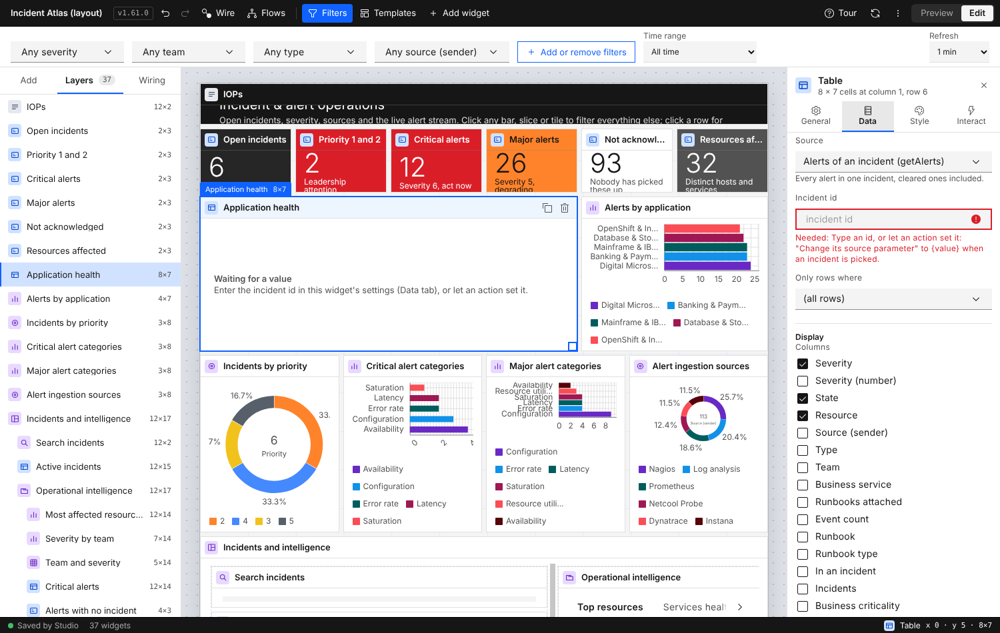

Type a value and the widget loads straight away:

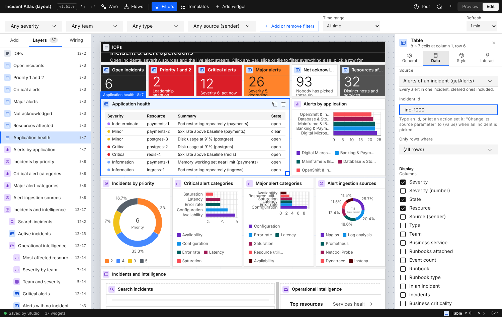

You rarely type ids by hand. Instead, let an action fill the parameter: **Change its source parameter** to `{value}` when an incident is picked elsewhere (section 7). That is how drill-downs are built.

**Tips**

- **Open alert count** and **Open incident count** are one fast number: use a Number widget with *Sum of Quantity*.
- **Policies** can be thousands of rows on a large tenant; allow a few seconds.
- Large tenants are protected: each source keeps at most 5,000 rows, a query times out after 60 s, only one load runs at a time, and refreshing pauses while the browser tab is hidden.

## 6. Filter bar, linking and drill-down

**The filter bar.** Turn it on with **Filters** in the toolbar. It offers dashboard-wide dropdowns (severity, team, type, source), **Add or remove filters** to choose which fields appear, a **Time range** and a **Refresh** interval. Every widget with *Follows the dashboard filter bar* (Interact tab) obeys it.

**Click-to-filter (linking).** On the Interact tab, set **When clicked** to filter other widgets. Clicking a bar, slice or row then sets a filter on every widget that uses the same source; the active filters show as chips under the toolbar (*Filtering by …*, with **Clear all**). Untick *Follows filters from other widgets* on any widget that should ignore them. The **Wiring** tab on the left lists who filters whom.

**Wire mode (designers).** **Wire** in the toolbar draws every link on the canvas. Drag from the ● dot on a chart or choice onto a widget to connect them; click a line for its menu (type, comparison, cut). Solid blue = a filter, purple = a typed value, dashed = automatic (every widget on the same data).

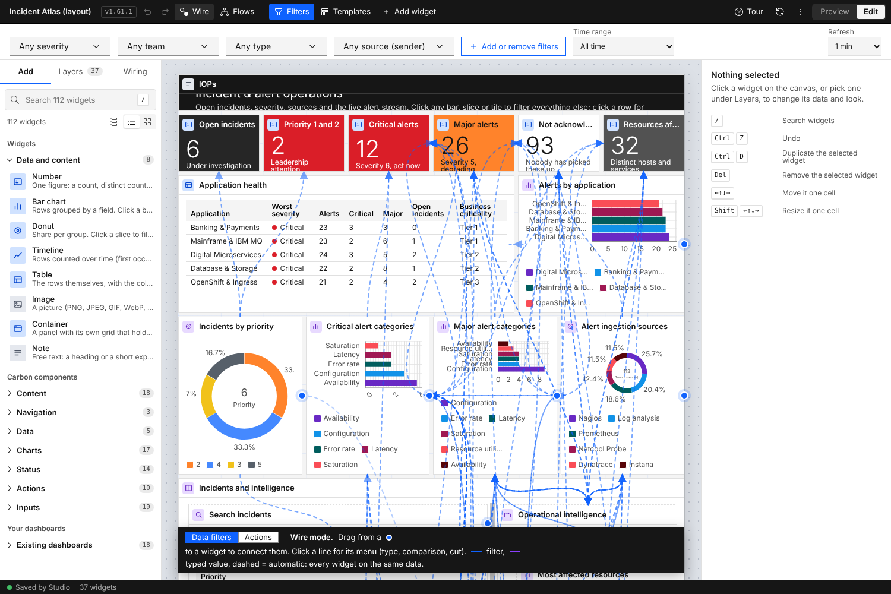

**Drill-down.** To show the details of what was picked, point a detail widget at the pick with an Action flow (section 7):

1. Add a picker: a table of incidents, or a dropdown.
2. Add detail widgets that read **Alerts of an incident**, **Alert groups of an incident** or **Related incidents**.
3. In **Flows**, connect the picker to each detail widget with **Change its source parameter** = `{value}`.

The **Incident drill-down** template is built exactly this way:

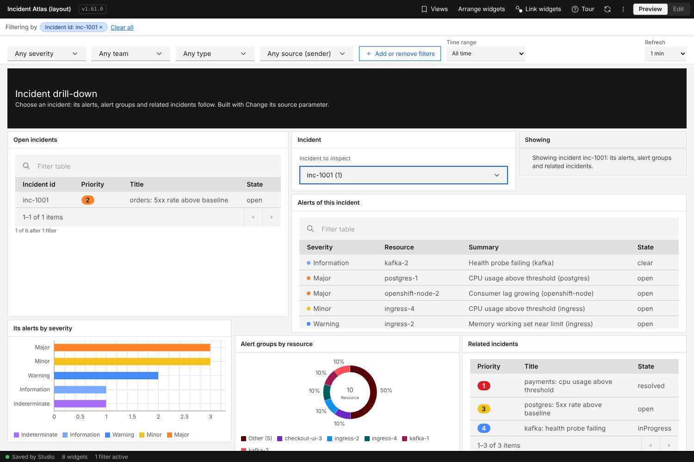

### What a click does

Per widget, on the Interact tab, **When clicked** (*Click on it to*):

| Choice | What happens |
| --- | --- |
| **Filter other widgets** | Sets a filter on every widget that uses the same source (charts and choices only) |
| **Show the rows behind it** | A side panel lists the rows behind the bar, slice or number, with an optional **Open** button to an address |
| **Open an address** | Opens a web or in-app address filled from the clicked row, e.g. `https://…/incidents/{id}` |
| **Do nothing** | |

**Links between dashboards.** Add `?db=field:value` to a dashboard's address to open it already filtered, for example `?db=severityLabel:Critical;state:open`. In an *Open an address* link, use the clicked row's values: `?db=severityLabel:{severityLabel}`.


## 7. The Action flows editor

Action flows make widgets react to each other: *when* something happens in one widget, *then* do something *on* another. Open it with **Flows** in the toolbar, or **Edit in Action flows** on a widget’s Interact tab. Flows run while the dashboard is used, never while you design.

### The three lanes

| Lane | Holds |
| --- | --- |
| **1 · When** | Triggers: a widget and the event it listens for (a value is picked, clicked, Enter pressed, value changes…) |
| **2 · Then** | Actions: what happens (show / hide, set its title, change its source parameter, create an incident…) |
| **3 · On** | Targets: the widget that changes, or **Concert Operate** itself |

### Build a flow in three moves

1. **Add trigger** (top right, or *Add a trigger* in the When lane) and pick the widget people interact with.
2. **Drag** from its blue port ● onto the widget that should change. While you drag, the On lane lists every widget (*Drop on any widget*):

    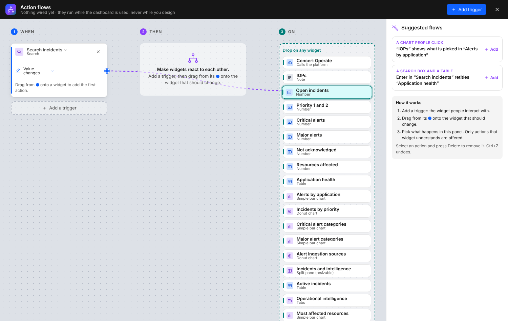

3. **Pick what happens** in the side panel. Only actions the target understands are offered, grouped (Concert Operate, Visibility, Data, Content, Settings) with a search box.

    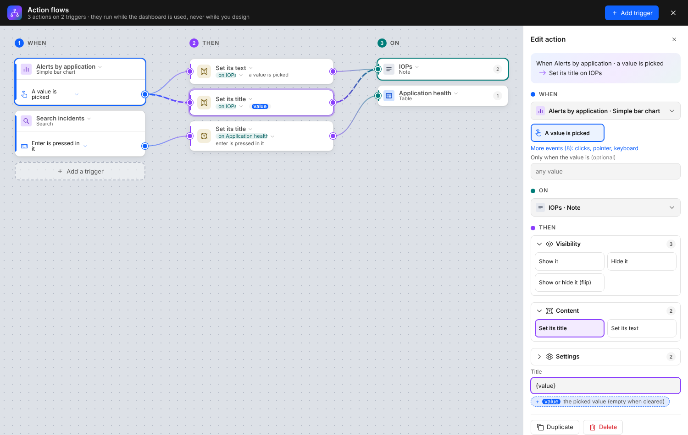

### The side panel

- A sentence at the top reads the flow back: *When Alerts by application · a value is picked → Set its title on IOPs*.
- **When**: the trigger widget, its event (**More events** shows clicks, pointer and keyboard events) and *Only when the value is* (optional).
- **On**: the target.
- **Then**: the action and its fields. Click the `value` chip to insert `{value}`, what the event carried (the picked value, the typed text…).
- **Duplicate** or **Delete** the action.

### Dropdowns on the tiles

You can change a flow straight on the canvas. Each tile has a small ⌄ menu: on a trigger, change its event or move all its actions; on an action, change what it does or its target; on a target, retarget all its actions.

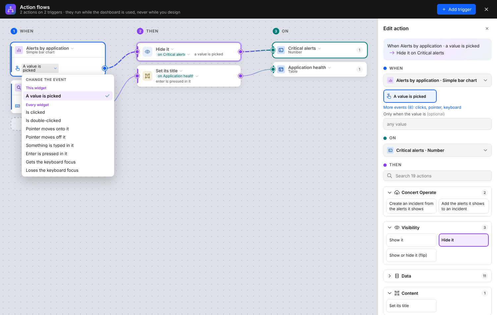

### Suggestions and shortcuts

With nothing selected, the panel shows **Suggested flows** for your dashboard (e.g. *a chart people click*, *a search box and a table*); **Add** creates one. Select an action and press `Delete` to remove it; `Ctrl Z` undoes.

## 8. Concert Operate actions

Some actions change data in Concert Operate itself. They are offered in two places.

**On a widget that shows alerts** (target = that widget):

| Action | Fields |
| --- | --- |
| Create an incident from the alerts it shows | Priority (1–5), Description |
| Add the alerts it shows to an incident | Incident (its correlation key) |

The alerts used are exactly the rows the widget shows: after its own condition, the filter bar and any click filters.

**On the Concert Operate target** (drop on *Concert Operate* in the On lane):

| Action | Fields |
| --- | --- |
| Create an incident | Alert ids, Priority, Description |
| Add alerts to an incident | Alert ids, Incident |
| Activate policies | Policies |
| Deploy a policy / Stop deploying a policy | Policy |
| Reject policies / Restore policies | Policies, Comment (optional) |
| Rename a policy | Policy, New name |

Fields default to `{value}`, so a search box or a picked row can supply the ids.

**Policies by name.** Policy fields accept **names or ids**, separated by commas. Names are looked up in the *Policies* source (exact match first, then ignoring case); names that match nothing are left out and listed in the confirmation.

**Safety.** Every Concert Operate action asks the viewer to confirm first (*This changes data in Concert Operate.*), then reports the result in a banner at the top:

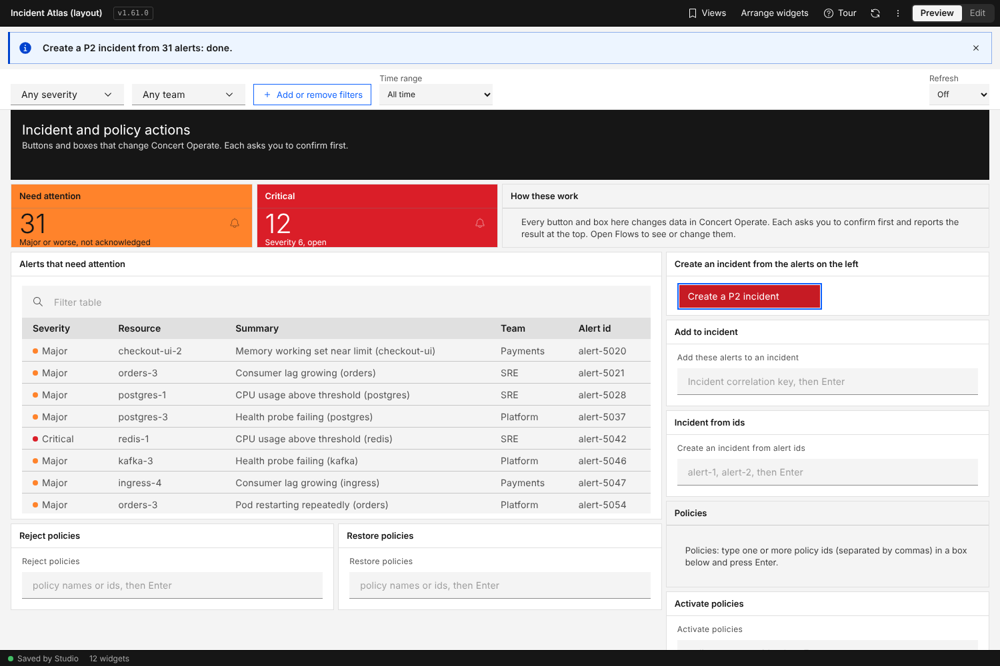

Locking and unlocking policies is not offered: current Concert Operate refuses it from the API.

## 9. Using a dashboard: Preview, View as, Arrange, Reset

Switch **Preview** (top right) to see the dashboard as viewers do; **Edit** brings the editor back. In Preview the toolbar changes:

| Control | What viewers can do |
| --- | --- |
| **Views** | Save the current filters, time range and links under a name, and switch between saved views |
| **Arrange widgets** | Move and resize widgets for themselves only |
| **Reset changes** | Undo everything they changed (layout, chart types, groupings) |
| **Link widgets** | Choose which widgets filter each other |
| **by …** menu | Regroup a chart (e.g. *by Priority* → *by Team*) |
| **as …** menu | Show a chart as another chart type |

### Resize and rewire at runtime (only for you)

Viewers can reshape a published dashboard without editing it. These changes are kept per person, in their browser, and nobody else sees them. **Reset changes** puts everything back as published.

**Arrange widgets.** Click it, then drag a widget by its title to move it, or drag its bottom-right corner to resize it. Click **Done arranging** to finish.

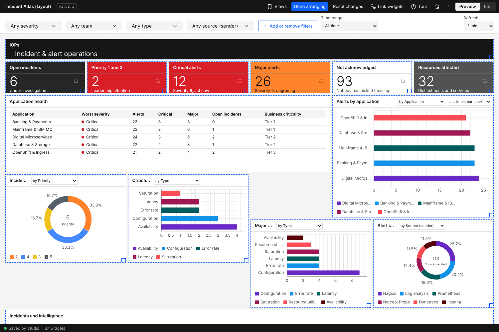

**Link widgets.** Click it to see the links between widgets. Drag from the ● dot on a chart or choice to the widgets it should filter; click a line to cut it. The **Filter bar** chip on each widget switches whether it follows the filter bar. Click **Done linking** to finish.

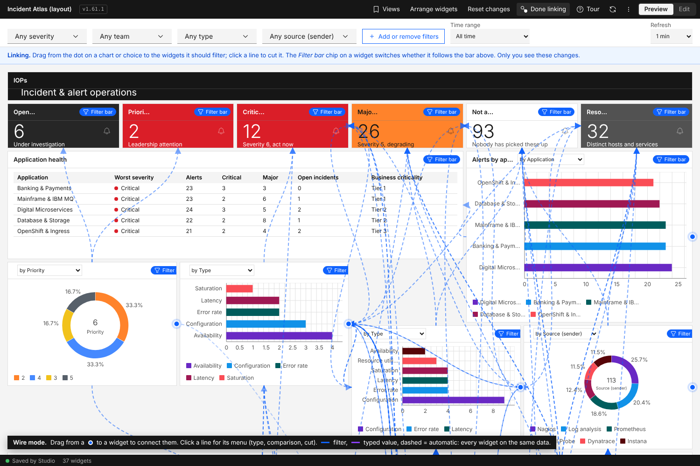

As the designer you decide what viewers may change, per widget on the Interact tab: *Viewers can move and resize this widget*, *Viewers can regroup this chart*, *Viewers can show it as another chart*. **Link widgets** appears only when the dashboard has widgets that can send filters.

### Saved views

**Views** saves the current filter bar, time range, links and groupings under a name, so a viewer can come back to them in one click. **Import a shared view** takes one a colleague sent.

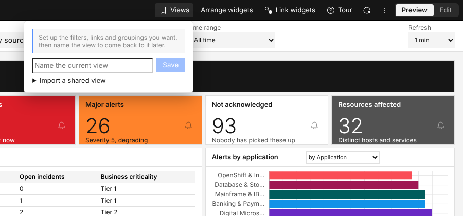

### Saving and sharing dashboards in Concert Operate

Inside Concert Operate the Designer saves automatically, in that person's browser. The ⋮ menu has **New dashboard**, **Duplicate**, **Rename**, **Delete**, **Export as JSON**, **Import JSON**, **Add the shared layout** (the starting dashboard, when one is set) and **Check the Concert Operate API**.

- To share with one person: **Export as JSON**, send the file, they **Import JSON**.
- To give everyone a dashboard: import the file in the Workbench (**Dashboards › Import from file…**), then **Publish** (section 12).

### View as: switch the chart type at runtime

Hover a chart and an **as …** menu appears next to its title. A viewer can turn a bar chart into a word cloud, a donut into a pie or a treemap, a number into a gauge. Only types that read the same data are offered, so nothing is lost and switching back restores the original exactly:

| Family | Interchangeable types |
| --- | --- |
| **Groups** | bar, donut, simple bar, lollipop, pie, treemap, word cloud, grouped bar, stacked bar, heatmap, radar |
| **Over time** | timeline, line, area, stacked area, scatter |
| **One figure** | number, gauge, meter |
| **Rows** | table, data table, structured list |

*Heatmap* is offered only when the chart has a second split (Data › **Series by**); without one there is nothing to compare.

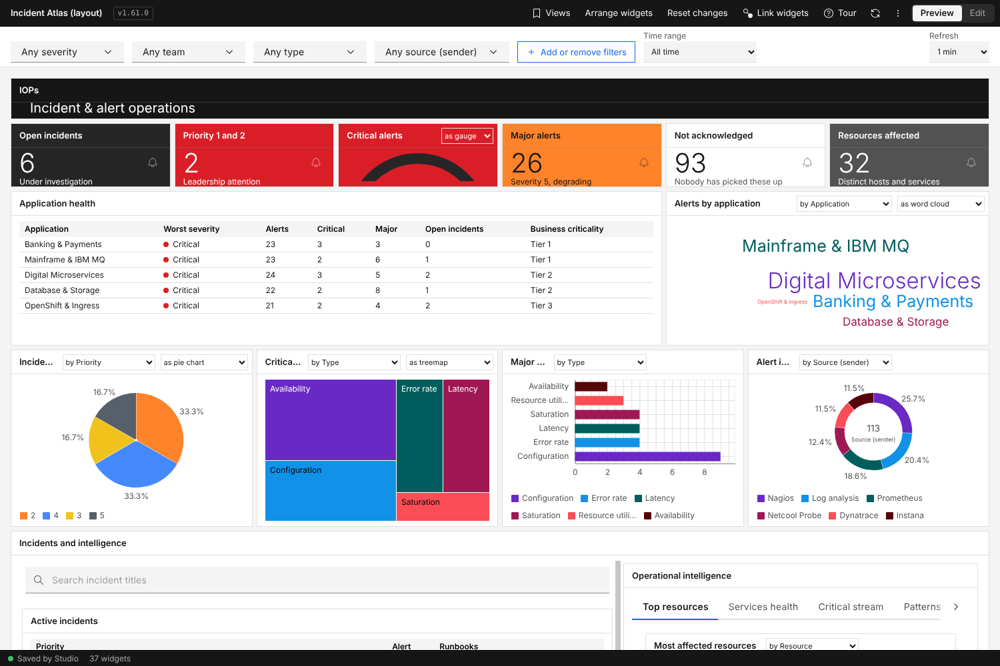

The choice is kept per viewer. As the designer you can turn it off per widget (Interact tab, *Viewers can show it as another chart*), or change it from a flow with the **Change its chart type** action.

## 10. Templates

**Templates** (toolbar) lists 29 ready-made dashboards. Applying one replaces the canvas; undo with `Ctrl Z`. Some worth opening to learn from:

| Template | Shows how to |
| --- | --- |
| **Incident command center**, **NOC command center**, **Operations overview** | Classic overview layouts with numbers, charts and click-to-filter |
| **Incident drill-down** | Pick an incident; its alerts, alert groups and related incidents follow (*Change its source parameter*) |
| **Alert filter lab** | Type a raw alert filter (e.g. `severity = 6`) and see matching alerts and their incidents |
| **Incident and policy actions** | Buttons and boxes that create incidents and change policies, each confirmed first |
| **Policy manager** | Find a policy, type its name, press Enter: activate, deploy, stop deploying, reject, restore |
| **Tenant configuration** | People, user groups, automation actions, tools and saved filters |
| **Chart gallery: compare / patterns** | Every chart type side by side |
| **Interactive controls** | Inputs (dropdowns, search, toggles) driving other widgets |

### Policy manager in use

The table lists every policy. Type one or more names (or ids), separated by commas, in a box and press Enter. Here *No such policy* matched nothing, so only one policy was activated:

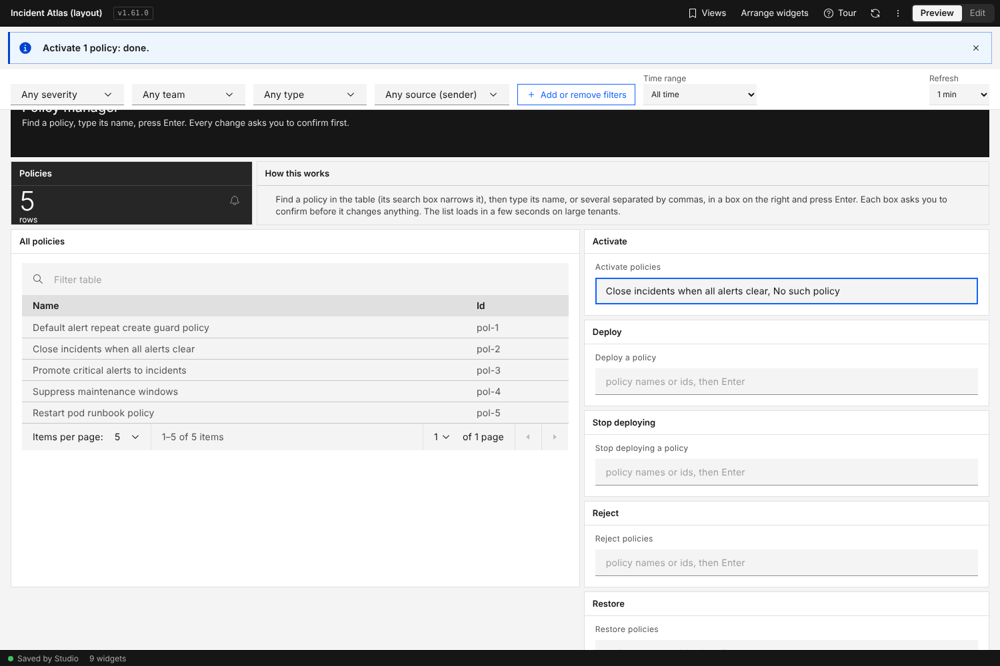

Open **Flows** on any template to see how it is wired.

## 11. API check

The **API check** (⋮ menu in the toolbar) tests the Designer against *your* Concert Operate. It calls every data source once and records the shape of each answer, so a reader that does not match your server can be found and fixed.

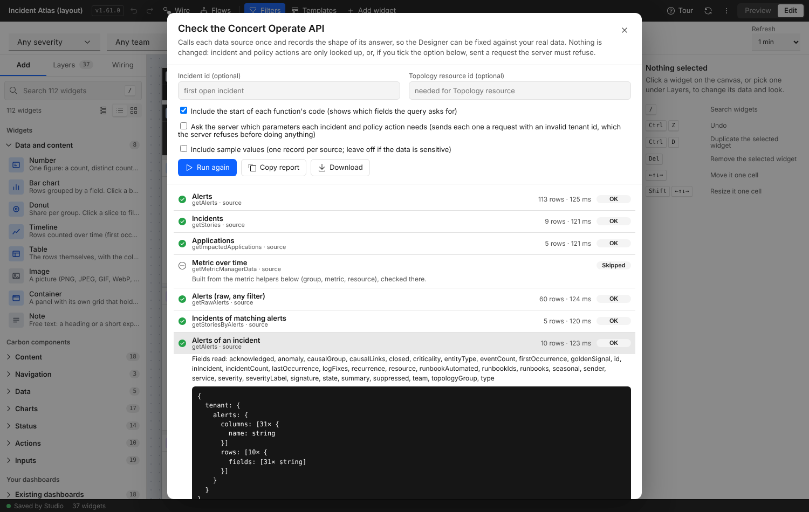

1. Optionally enter an **Incident id** and a **Topology resource id** (otherwise the first open incident is used; the topology check is skipped).
2. Choose the options:
    - *Include the start of each function’s code*: shows which fields each query asks for.
    - *Ask the server which parameters each incident and policy action needs*: sends each action a request with an invalid tenant id, which the server refuses before doing anything. Nothing is changed.
    - *Include sample values*: one record per source. Leave it off if the data is sensitive.
3. Press **Run**. Each row shows OK / failed / skipped, rows returned and time; click a row for the fields read and the answer’s shape.
4. **Copy report** or **Download** it to share when something fails.

Run it once after each deploy to a new tenant or Concert Operate upgrade.

## 12. Publishing and deploying

### In the Workbench

1. **Save** keeps the dashboard in the Workbench (*Saved in Studio*). **Dashboards ▾** opens saved ones; **…** renames, duplicates or deletes.
2. **Publish** adds it to the sidebar menu of the extension.
3. The **Deploy** tab builds and deploys to the cluster.

### More in the Workbench

- **Dashboards ▾**: open a saved dashboard, **New dashboard…**, **Import from file…**, **Duplicate**, **Export to file**, **Delete dashboard…**.
- **⋯** (next to the name): **Row height**; **Make this everyone's starting dashboard** (every user's Designer opens with it; saves and deploys); **Stop using a starting dashboard**; **Remove from the sidebar** (unpublishes; the file stays); **Publish all starter templates…**.
- **Deploy** tab: the live build and deploy log.

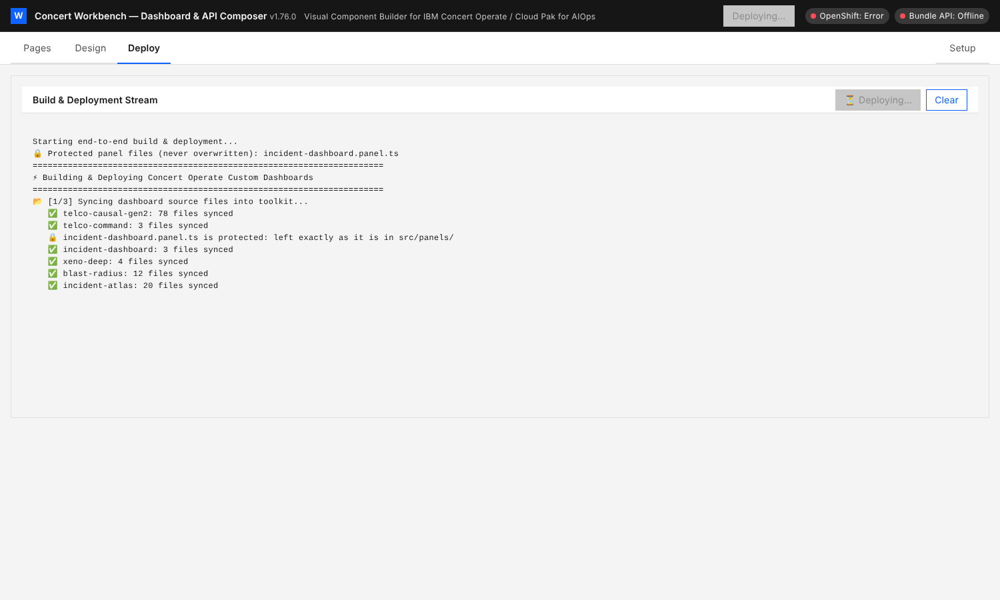

### Versions in git

Published dashboards are files in the repository, so git keeps their history. The Workbench does the git steps for you, with your own git login.

**Setup › Git** shows the repository, remote and branch, and sets:

- the **author** name and email for commits;
- the **allowed branches** Studio may commit to (at first, the branch you are on);
- **Commit when I publish**: Publish also commits (pushing stays a separate step).

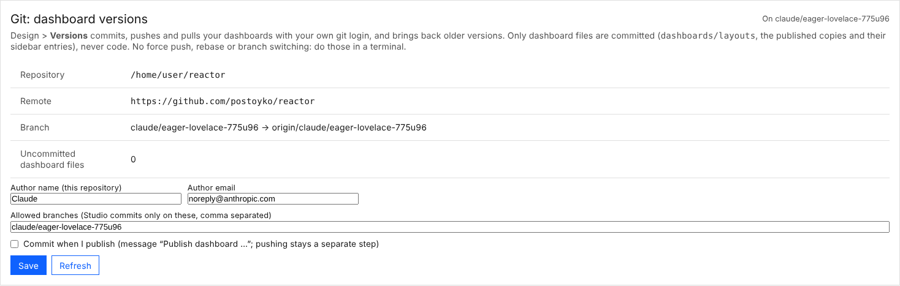

**Design › Versions** (next to Dashboards; the badge counts uncommitted files):

| Item | What it does |
| --- | --- |
| **Commit N changed files…** | Shows the files and asks for a message. Commits dashboard files only: layouts, published copies and sidebar entries. Never code, and never files you staged yourself |
| **Push** | Sends your commits to the remote branch. Never forced |
| **Pull** | Brings in what others pushed. If the same dashboard changed on both sides it stops, changes nothing and names the files |
| **History of this dashboard…** | Every committed version, with when, who and the message |

<div class="narrow2" markdown="1">
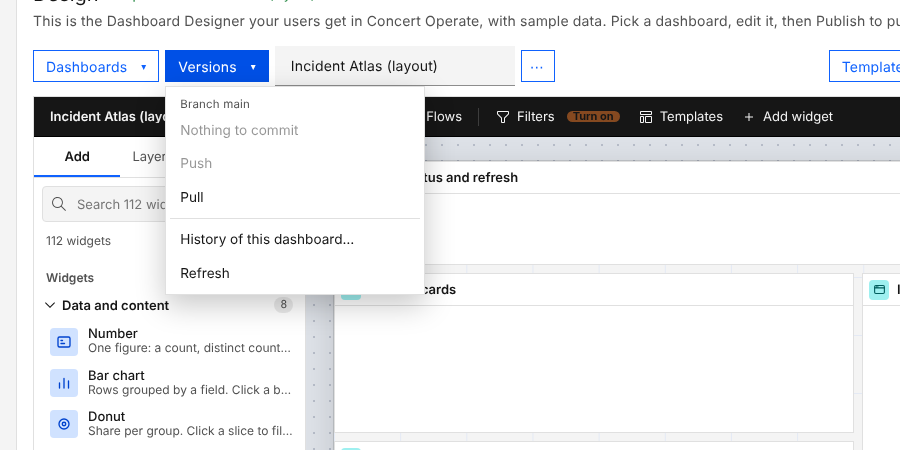
</div>

**Bringing back an old version.** In the history, **Open** a version: it loads into the editor as unsaved changes. Nothing changes until you **Save**; then **Publish** and **Commit**. The old version becomes the newest one, and history is never rewritten.

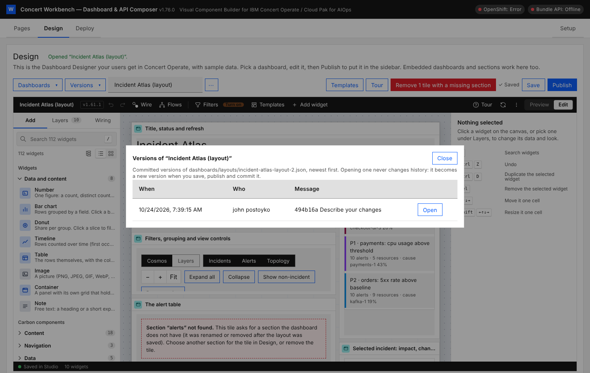

Studio refuses to commit on a branch that is not allowed, with no branch checked out, or while a merge or rebase is unfinished. Branch switching, rebasing and force pushing stay in the terminal.

### Git from the terminal

The Workbench covers commit, push, pull and history. For everything else:

| Task | Command |
| --- | --- |
| Where am I, what changed? | `git branch --show-current` · `git status` |
| Get the latest | `git pull` |
| Switch to another branch | `git fetch origin` then `git checkout <branch>` |
| Start a branch for a bigger change | `git checkout -b dash/<name>` then `git push -u origin dash/<name>`; add it under Setup › Git › Allowed branches |
| History of one dashboard | `git log --oneline -- dashboards/layouts/<name>.json` |
| What changed in it | `git diff -- dashboards/layouts/<name>.json` |
| Throw away uncommitted edits to it | `git restore dashboards/layouts/<name>.json` |
| Bring back an old version | `git checkout <sha> -- dashboards/layouts/<name>.json`, then in the Workbench open it, **Save**, **Publish** and **Commit** |
| Undo a commit that was pushed | `git revert <sha>` (adds a new commit; never rewrite pushed history) |

**When Pull reports a conflict** (the same dashboard changed on both sides):

1. In a terminal, run `git pull`. git lists the files in conflict.
2. A dashboard file is easiest to settle by keeping one side whole: `git checkout --theirs <file>` keeps the version from the remote, `git checkout --ours <file>` keeps yours. Do the same for every file listed.
3. `git add <files>` then `git commit`.
4. In the Workbench, open the dashboard, **Save** and **Publish**: this rewrites the generated copies, so they match the version you kept. Then **Commit** and **Push**.

### From the command line

```
cd dashboard-extension && npm ci && cd ..
./deploy-dashboards.sh
```

The dashboards appear in Concert Operate’s sidebar under **Reactor**. Existing menus such as *Custom dashboards* stay as they are.

### Changing the Designer itself

The master copy is `scaffold/designer/`. After editing it:

```
./sync-designer.sh                                 # copy to dashboards/dashboard-builder
./sync-designer.sh --check                         # the two copies match
cd dashboard-extension && npm run test:designer    # unit tests, type check and lint
```

The deploy stops if the two copies differ (`./sync-designer.sh --back` keeps edits made in `dashboards/dashboard-builder/` instead). GitHub runs the same checks on every push (*Designer checks*).

### Checklist before going live

- ☐ Every widget loads in Preview (no *Waiting for a value* left).
- ☐ Flows tested in Preview; Concert Operate actions confirmed on a test incident or policy.
- ☐ API check run against the target tenant.
- ☐ Committed and pushed (Design › Versions).
- ☐ Saved, published and deployed; the dashboard opens from **Reactor** in the sidebar.

## 13. Code dashboards and AI: use the contract

Build in the Designer first. Write a code dashboard only for what the Designer cannot do (a new kind of visual, a source it does not read).

> **Best practice: whenever a dashboard is written in code, by a person or an AI, give them `scaffold/DASHBOARD-CONTRACT.md` and require it.** It sets the folder layout, the shape that lets the Workbench split the dashboard into reusable tiles, and the rules learnt from the real API: which functions fail on Concert Operate and what to use instead, large-tenant limits, confirming every change to data, no keys or tenant ids in code.

1. Give the AI the contract file and the prompt at the end of it (section 7 of the contract), plus what the dashboard is for.
2. Put the result in `dashboards/<id>/`.
3. In the Workbench, **Setup › Split dashboards into tiles › Check**: aim for *Ready* or *Mostly automatic*, with no findings marked bad.
4. Check its readers against the real tenant with the API check (section 11), and test any change to data on a non-critical item first.
5. Deploy, then commit it like any other change.

The contract is also served by the Workbench at http://127.0.0.1:4000/api/contract.

## 14. Troubleshooting

| Symptom | What to do |
| --- | --- |
| A new or changed page does not show in Concert Operate | Hard-refresh (`Cmd+Shift+R`). On the Pages tab, check **Deploy** and **In sidebar** are on, then deploy again |
| A widget says **Waiting for a value** | Its source needs a parameter: fill it on the Data tab, or let a flow set it (section 5) |
| A widget shows an error, or no rows, on the real tenant | Run the API check (section 11) and share the report |
| Tiles say *Section not found* / **Remove N tiles with a missing section** | The embedded dashboard changed since the layout was saved: remove those tiles, or pick another section for each |
| Design tab says packages are missing | `cd dashboard-extension && npm ci`, then reopen the tab |
| *Cannot reach Studio server* | The Workbench stopped: start `node server.mjs` again |
| Deploy stops at authentication | Set `OPENSHIFT_PASSWORD` in that terminal and check `dashboard-extension/target.json` |
| Versions: *Studio may not commit to …* | Add the branch under Setup › Git › Allowed branches, or switch branch |
| Versions: Pull refused, same files changed | See *Git from the terminal* above |
| Slow on a large tenant | Policies and raw alerts can take seconds; narrow with filters. Each source keeps at most 5,000 rows and the widget says when it was cut |
| A Concert Operate action reports an error | Read the banner: it quotes the server. Policy lock and unlock are not supported by the server |

## 15. How it all connects: interaction diagrams

Every interaction, drawn from the code. The same diagrams, as editable Mermaid, are in `docs/ui-interactions.md` (GitHub draws them).

### From idea to Concert Operate


### Editor modes


### The editor's parts


### Building a widget


### How data reaches a widget


### What a click does


### Building an Action flow


### A flow at runtime: the drill-down

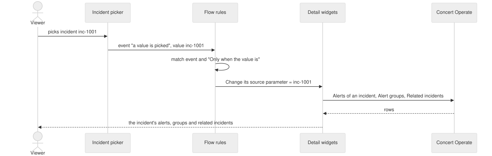

### A Concert Operate action

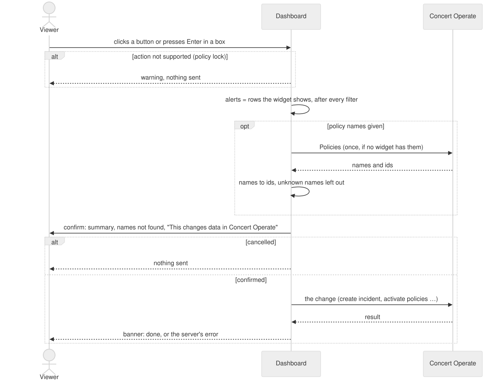

### Changes a viewer makes for themselves


### Dashboard versions in git


### The API check


### Deploying


