# Dashboard Designer: how the UI interactions work

Diagrams of every interaction in the Dashboard Designer and the Concert Workbench, drawn from the code (Designer v1.61,
Workbench v1.76). GitHub draws them; the tutorial (`docs/dashboard-designer-tutorial.html`, section 15) has the same
diagrams as pictures.

## 1. From idea to Concert Operate

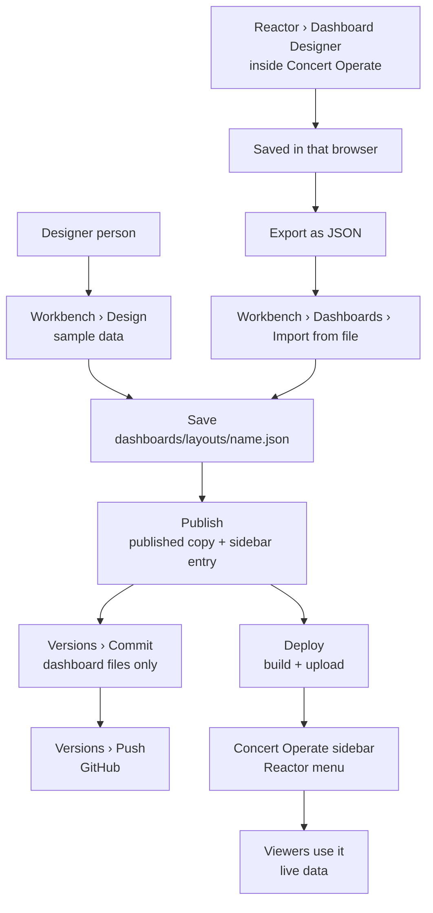

## 2. Editor modes

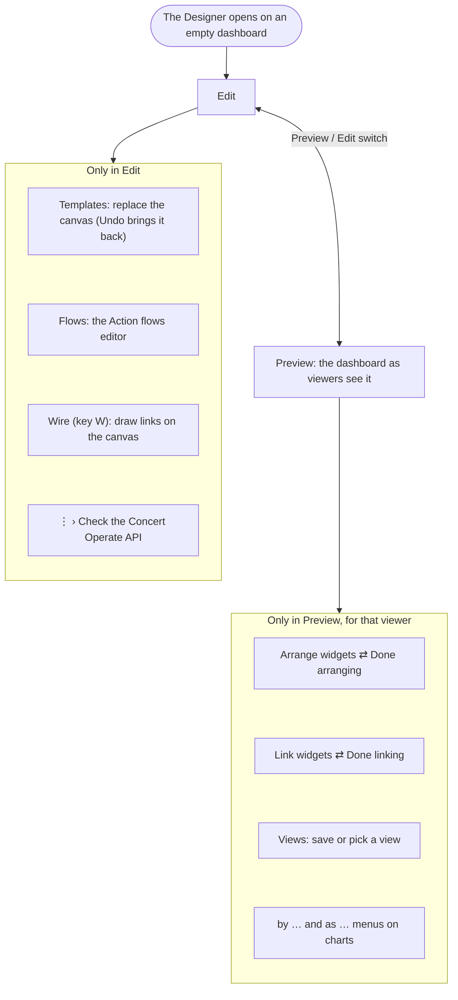

## 3. The editor's parts

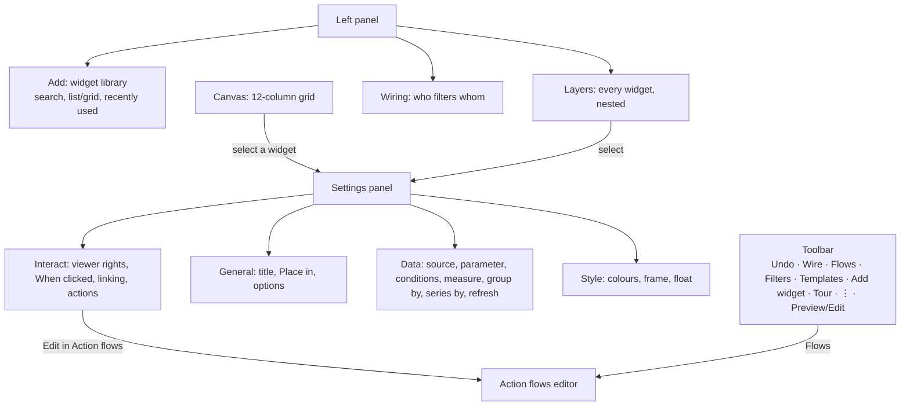

## 4. Building a widget

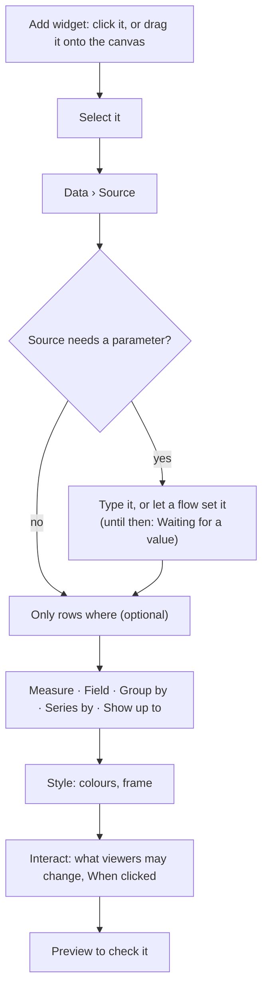

## 5. How data reaches a widget

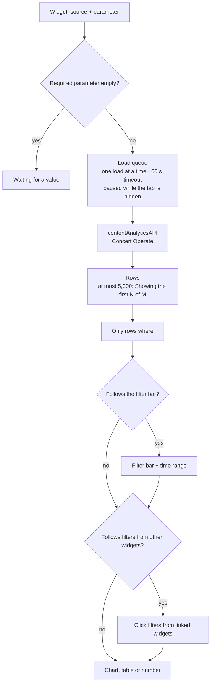

## 6. What a click does

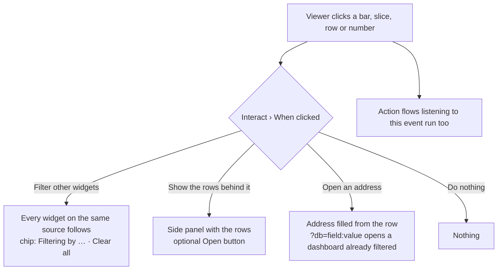

## 7. Building an Action flow

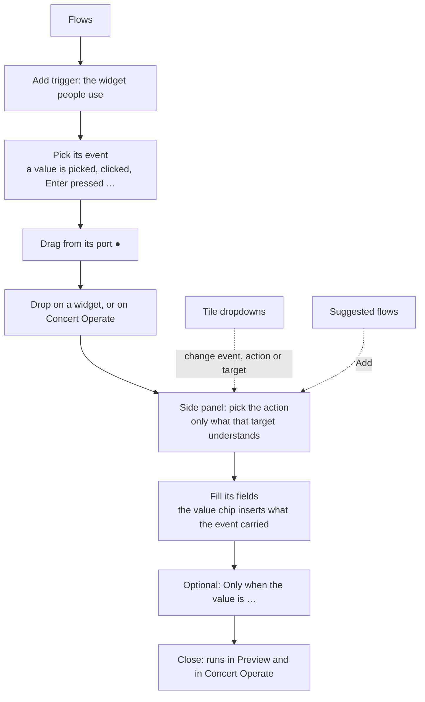

## 8. A flow at runtime: the drill-down

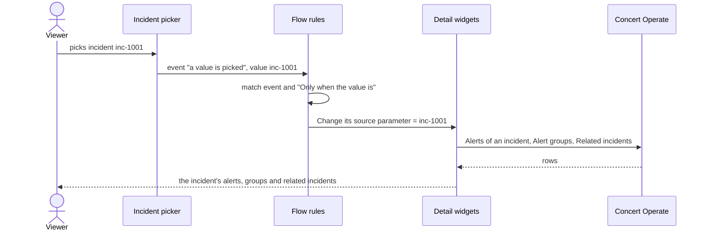

## 9. A Concert Operate action

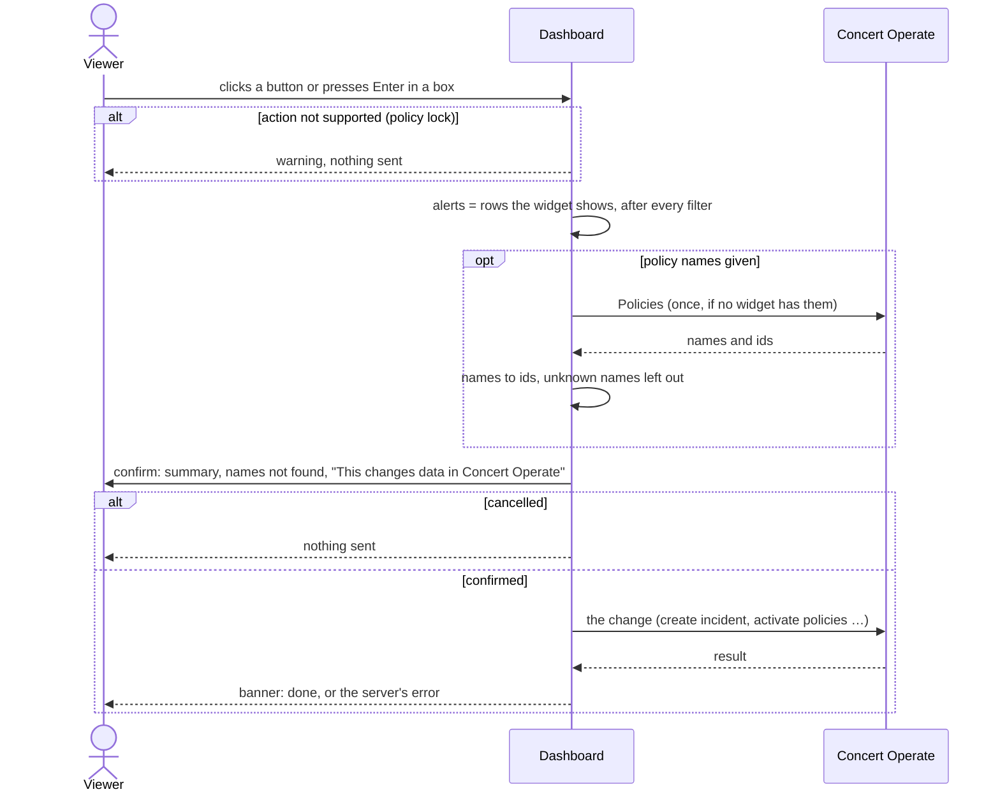

## 10. Changes a viewer makes for themselves

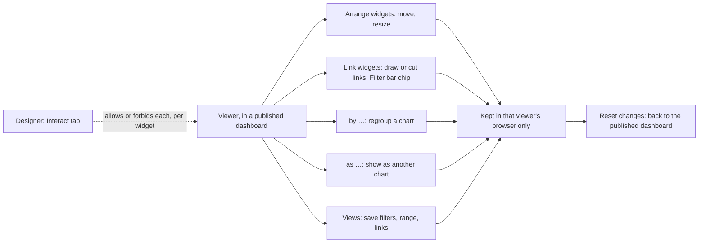

## 11. Dashboard versions in git

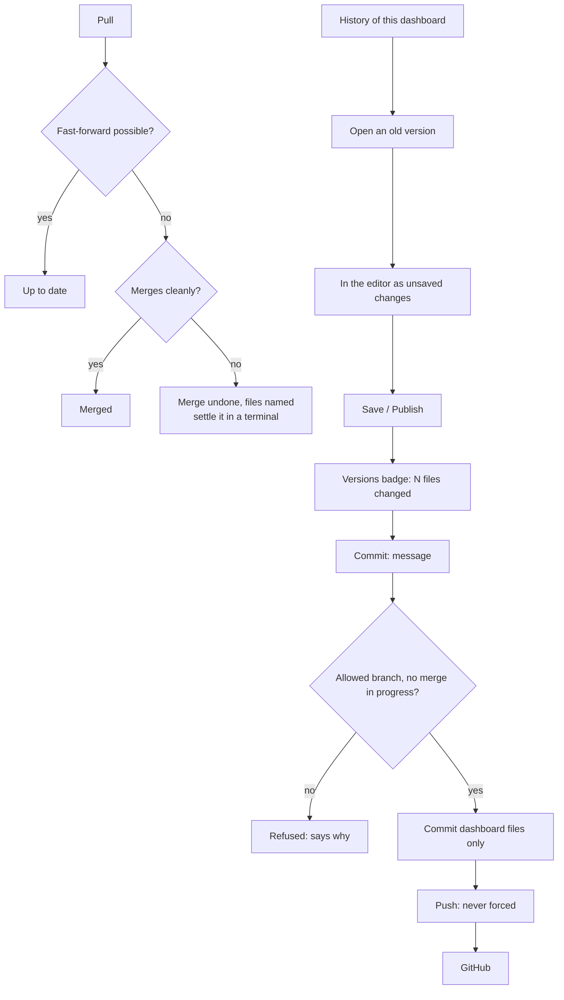

## 12. The API check

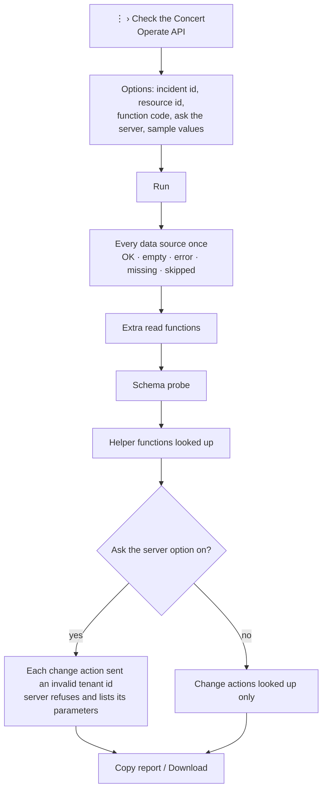

## 13. Deploying

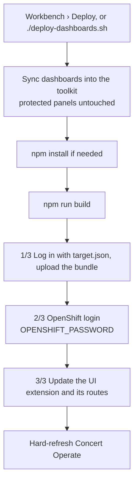
